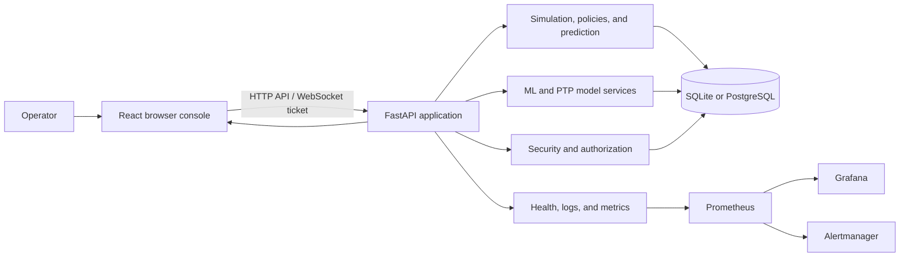

<div align="center">

# EntangleOps

**VTU-QFF-HC-0066** &nbsp;|&nbsp; Tier: **Both**

**A research workbench for quantum networks sharing fiber with classical traffic.**

</div>

---

<div align="center">

| | |
| :--- | :--- |
| **Team** | Quant Rangers |
| **Team ID** | VTU-QFF-HC-0066 |
| **Tier** | Both |
| **Repository** | [vtu-hc-quant-rangers](https://github.com/vtu-qiskit-fall-fest-2026/vtu-hc-quant-rangers.git) |
| **Organisation** | [vtu-qiskit-fall-fest-2026](https://github.com/vtu-qiskit-fall-fest-2026) |
| **Event** | VTU-QFF Hackathon — VTU-Qiskit Fall Fest 2026 |

</div>

---

## 📌 Table of Contents

- [Team Members](#-team-members-github-ids)
- [Problem Statement](#-problem-statement)
- [Proposed Solution](#-proposed-solution)
- [Approach & Architecture](#-approach--architecture)
- [Tech Stack](#-tech-stack)
- [Project Structure](#-project-structure)
- [How to Run](#-how-to-run)
- [How to Push Code](#-how-to-push-code)
- [Submission Checklist](#-submission-checklist)
- [Resources](#-resources)
- [License](#-license)

---

## 👥 Team Members (GitHub IDs)

| # | Name | GitHub Username | Role |
| :-- | :--- | :--- | :--- |
| 1 | Rebecca Dsouza | [@axorarbxy](https://github.com/axorarbxy) | Team Lead |
| 2 | Mangirish Prabhavalkar | [@Mangirish25](https://github.com/Mangirish25) | Developer |

---

## ❓ Problem Statement

**Problem:** Quantum-network researchers need to study how quantum links behave when they share fiber with classical traffic, changing environmental conditions, and competing allocation policies. Without a reproducible workbench, comparing scenarios, tracking results, and inspecting system behavior is difficult.

**Why it matters:** Classical traffic and link conditions can affect the quality and availability of quantum links. A repeatable simulator helps researchers explore trade-offs and compare policies before testing assumptions in a physical network.

**Track / Category:** Quantum networking and hybrid classical–quantum infrastructure · Tier: Both. This project models and analyzes networks; it does not control quantum hardware.

---

## 💡 Proposed Solution

**Solution:** EntangleOps is a browser-based research workbench with a FastAPI service for network simulation, policy comparison, and prediction. It includes persistent run history, a React console for scenarios and results, model and experiment metadata, and monitoring/security components for operating the application.

**Key idea:** Use seeded scenarios and analytic link estimates to make policy comparisons repeatable, then retain their results and model evidence for inspection.

**Why this works:** The same generated environment and request set can be reused across baseline policies, making comparisons easier to reproduce. SQL persistence, API-key roles, audit records, and service telemetry connect the analysis workflow to operational controls.

Core capabilities include two built-in metro topologies, seeded traffic and environmental traces, C-band/O-band link estimates, static/adaptive allocation and benchmark comparison, persisted run replay, Werner-fidelity prediction, ML experiment/model metadata, and a separate PTP delay prediction endpoint. Model training, evaluation, and promotion are CLI workflows; model browsing in the console is read-only. The Werner prediction workflow uses synthetic data, and a calibrated interval is available only when the active model has calibration for the requested alpha.

---

## 🧩 Approach & Architecture



1. **Input** — An operator signs in with an API key and submits a network topology, scenario, seed, and allocation policy through the browser console or REST API.
2. **Preprocessing** — The API validates fields and compute budgets, checks the key's role and ownership, and generates reproducible environment and traffic traces.
3. **Simulation core** — Analytic C-band/O-band link estimates feed static or adaptive allocation policies. Prediction endpoints estimate Werner fidelity; a separate SLATE-PTP model estimates one-way PTP delay from measurements and run conditions.
4. **Post-processing** — Simulation and benchmark results are summarized and persisted with their steps. The console can poll status and replay persisted steps over a short-lived, single-use WebSocket ticket.
5. **Output** — Users inspect topology, runs, benchmarks, time series, predictions, model metadata, and operational health in the console. Prometheus, Grafana, and Alertmanager configuration supports service monitoring.

The physics are illustrative and are not calibrated to a particular experiment. The included simulator is software only; it makes no quantum-security guarantee and does not control physical network equipment. Runs execute as in-process background tasks rather than through a durable job queue.

The main API uses `X-API-Key` with hierarchical `viewer`, `operator`, and `admin` roles. It exposes topology, simulation, time-series, benchmark, prediction, model/experiment, PTP-delay, and admin key/audit/health routes under `/api/v1`; health routes are under `/health`, metrics at `/metrics`, and completed-run replay uses `/ws/simulations/{rid}` with a one-use ticket. Run and benchmark creation require operator or admin access; reads are scoped to the owning key. Development OpenAPI documentation is available at `/docs` when enabled.

Persistent records include API keys, audit events, runs and steps, benchmarks and results, WebSocket ticket nonces, datasets, model artifacts, baselines, and ML experiments. Alembic migrations define the schema; SQLite is the local default and PostgreSQL 16 is used by the database Compose overlay. PostgreSQL separates the migration owner from the least-privileged `eo_app` runtime role. Model files remain filesystem artifacts, so deployments must persist that storage alongside the database.

Security and monitoring are part of the application path: API-key secrets are stored as peppered HMAC digests, admin actions are audited, request sizes/rates/run budgets are bounded, WebSocket tickets are short-lived and single-use, and model artifacts are signature-checked. Prometheus metrics are token-protected when enabled; health/readiness endpoints and structured logs support operations. Some rate-limit buckets, worker slots, and WebSocket counters are process-local. Alert thresholds are provisional, and Alertmanager needs a real receiver configured before it can send notifications.

---

## 🛠️ Tech Stack

| Layer | Technology |
| :--- | :--- |
| Backend and API | Python 3.11+, FastAPI, Pydantic 2, Uvicorn |
| Frontend | React 18, TypeScript 5, Vite, React Router |
| UI and charts | Tailwind CSS, Recharts, Lucide, TanStack Query, Zustand |
| Network simulation | Python, NumPy, SciPy, NetworkX; analytic link and allocation models |
| Machine learning | scikit-learn, joblib; synthetic Werner-fidelity workflow and SLATE-PTP delay model |
| Persistence | SQLAlchemy, Alembic, SQLite for local development, PostgreSQL 16 in Compose |
| Security | Role-based API keys, HMAC digests, audit logging, signed model artifacts, request controls |
| Monitoring | Prometheus, Grafana, Alertmanager, Caddy, structured application logs |
| Testing and quality | pytest, Vitest, ESLint, TypeScript, Ruff, Bandit |
| Deployment | Docker Compose, Nginx frontend container, Caddy reverse proxy |
| Version control | Git + GitHub |

The connected demo (`npm run dev:demo`) uses the local API and persistent database; `npm run dev:fixtures` runs offline synthetic frontend fixtures. Connected demo simulations are persisted locally but remain illustrative, not physical measurements. The SeQUeNCe cross-check is an unavailable stub, and no physical-network validation, production-scale test, penetration test, or live hosted demo is claimed.

---

## 📁 Project Structure

```text
EntangleOps/
├── README.md                         # Project overview and hackathon submission details
├── backend/                          # FastAPI app, simulation services, tests, and scripts
│   ├── app/api/                       # REST and WebSocket endpoints
│   ├── app/core/                      # Topology, physics, policies, simulator, prediction
│   ├── app/db/                        # Database models, sessions, and repositories
│   ├── app/ml/                        # Model features, inference, calibration, and registry
│   └── tests/                         # Backend API, database, security, and monitoring tests
├── database/                         # Alembic configuration, migrations, and PostgreSQL setup
├── frontend/                         # React and TypeScript browser console
├── machine_learning/                 # Training/evaluation CLIs, tests, PTP model, and reports
├── monitoring/                       # Prometheus, Grafana, Alertmanager, and health configuration
├── security/                          # Authentication, authorization, audit, and security controls
├── data/                              # Local or generated data (runtime data is ignored by Git)
├── docs/                              # README accuracy and testing-gap reports
├── docker-compose.yml                # Application and reverse-proxy services
├── docker-compose.db.yml             # PostgreSQL and migration overlay
├── docker-compose.monitoring.yml     # Monitoring overlay
└── .github/workflows/                # CI quality and security workflows
```

---

## 🚀 How to Run

### Prerequisites

- Python 3.11 or newer and pip
- Node.js 20 and npm
- Docker Desktop with Docker Compose v2 for the full stack
- [Git](https://git-scm.com/downloads)
- A GitHub account with access to the team repository if you need to push code

### 1. Clone the repository

```bash
git clone https://github.com/vtu-qiskit-fall-fest-2026/vtu-hc-quant-rangers.git
cd vtu-hc-quant-rangers
```

### 2. Create a virtual environment

```bash
python -m venv .venv
# Windows PowerShell
.venv\Scripts\Activate.ps1
# Linux / macOS: source .venv/bin/activate
```

### 3. Install dependencies

```bash
python -m pip install --upgrade pip
python -m pip install -r backend/requirements-dev.txt
cd frontend
npm ci
cd ..
```

### 4. Run

For the full application, generate local database and monitoring secret files, then configure the ignored `backend/.env` and root `.env` using the settings described in the current deployment configuration. Set distinct secure values for `EO_API_KEY_PEPPER` and `EO_MODEL_SIGNING_KEY`, configure `EO_CORS_ORIGINS`, make `EO_METRICS_TOKEN` match the monitoring token, and set `GRAFANA_ADMIN_PASSWORD`. Never commit these files or secret values.

```bash
python backend/scripts/gen_db_secrets.py
python backend/scripts/gen_monitoring_secrets.py
docker compose -f docker-compose.yml -f docker-compose.db.yml -f docker-compose.monitoring.yml up --build -d
```

Open `http://localhost/`. Create an administrator API key inside the running backend, then use the printed key once to sign in:

```bash
docker compose -f docker-compose.yml -f docker-compose.db.yml -f docker-compose.monitoring.yml \
  exec backend python scripts/manage_keys.py create --name local-admin --role admin
```

The command prints the API key once; the UI accepts keys in `eo_<key-id>.<secret>` form. For an integrated local demo using persistent SQLite instead of Docker, start `backend/scripts/demo.ps1` from PowerShell in one terminal, then create an operator key in another terminal with `backend/scripts/demo.ps1 -Action create-key`. In `frontend/`, run `npm ci` and `npm run dev:demo`; open `http://localhost:5173` and sign in with the generated key. The demo database and model files live under `backend/data/demo/` and persist across restarts without changing the normal local database. The host Alembic path discovery now searches for the repository migration config, so local migrations can run from this checkout.

The Compose deployment includes Caddy, the static frontend, FastAPI, PostgreSQL, a one-shot migration service, Prometheus, Grafana, and Alertmanager. The app is configured to run as a non-root container with a read-only root filesystem and reduced capabilities. Fresh deployments create an empty database and do not seed an API key; named database and monitoring volumes persist state across restarts. Do not remove the database volume unless its data can be discarded.

### 5. Run the tests

Backend and ML tests:

```bash
cd backend
pytest -q tests
pytest -q ../machine_learning/tests/test_ml.py
```

Frontend checks:

```bash
cd frontend
npm run lint
npm run typecheck
npm test
npm run build
```

The repository README accuracy and testing-gap reports document known host-side test and CI path issues. A complete green end-to-end test run has not been established.

Frontend `npm run e2e` invokes Playwright, but tracked Playwright specs/configuration were not found. The `npm run contract` script needs `EO_API_BASE` and `EO_API_KEY` for a running API and checks a short authenticated run flow. In the documented validation, targeted backend physics tests passed, frontend lint/typecheck/build and 11 Vitest tests passed, while 2 of 7 ML tests failed because host-side Alembic config discovery lacks `script_location`. The complete backend suite did not receive a final result, and the security workflow references the absent `backend/tests/test_ml.py` instead of `machine_learning/tests/test_ml.py`.

---

## 🔁 How to Push Code

> Push access requires **write permission** to the team repository. Being listed as a contributor or having commits attributed to your account does not by itself guarantee permission to push. Accept the collaborator invitation and use the GitHub account that has been granted access.

### Configure Git (first time only)

```bash
git config --global user.name  "Your Name"
git config --global user.email "you@example.com"
```

### Everyday workflow

```bash
# 1. Get the latest changes
git checkout main
git pull origin main

# 2. Create a branch for your work
git checkout -b feature/my-task

# 3. Commit your work
git add .
git commit -m "docs: describe current implementation"

# 4. Push the branch
git push -u origin feature/my-task

# 5. Open a Pull Request on GitHub and request a review
#    https://github.com/vtu-qiskit-fall-fest-2026/vtu-hc-quant-rangers/compare/main...feature/my-task

# 6. After approval, merge into main
git checkout main
git pull origin main
git branch -d feature/my-task
```

### Commit message convention

| Prefix | Meaning |
| :--- | :--- |
| `feat:` | New feature |
| `fix:` | Bug fix |
| `docs:` | Documentation only |
| `test:` | Adding or fixing tests |
| `refactor:` | Code restructure, no behaviour change |
| `chore:` | Build/config/dependency changes |

### Useful commands

```bash
git status              # what changed
git log --oneline -10   # recent commits
git diff                # review changes before committing
git stash               # shelve changes temporarily
git pull --rebase       # update your branch on top of main
```

### Collaborating on the same repo

- **Use a feature branch and Pull Request** unless the repository maintainers explicitly allow direct pushes to `main`.
- **Pull before you push** to avoid rejected commits.
- **Commit often** with clear messages.
- **Resolve conflicts** locally: `git pull --rebase`, fix the files, then `git add` + `git rebase --continue`.
- **Ask for a review** before merging so changes are checked by another contributor.

---

## ✅ Submission Checklist

- [x] Team repository visibility and submission settings confirmed
- [x] All team members added with the required repository access and invitations accepted
- [x] `README.md` updated with project details, problem statement, and solution
- [x] Team members listed under [Team Members](#-team-members-github-ids)
- [x] Backend and frontend dependency manifests and lockfiles committed
- [x] Latest project changes pushed to the hackathon repository and its default branch builds successfully
- [x] Generated runtime data, secrets, and local database files excluded from source control
- [x] README includes a reviewed project screenshot or demo video link
- [x] Short project summary submitted on the hackathon portal

---

## 📚 Resources

| Resource | Link |
| :--- | :--- |
| 🧭 Project repository | [Quant Rangers — vtu-hc-quant-rangers](https://github.com/vtu-qiskit-fall-fest-2026/vtu-hc-quant-rangers) |
| ⚛️ Qiskit documentation | [IBM Quantum documentation](https://docs.quantum.ibm.com/) |
| ⚡ FastAPI | [FastAPI documentation](https://fastapi.tiangolo.com/) |
| ⚛️ React | [React documentation](https://react.dev/) |
| 🐘 PostgreSQL | [PostgreSQL documentation](https://www.postgresql.org/docs/) |
| 🐳 Docker Compose | [Docker Compose documentation](https://docs.docker.com/compose/) |
| 📈 Prometheus | [Prometheus documentation](https://prometheus.io/docs/) |
| 🗂️ README accuracy report | [README accuracy summary](docs/README_ACCURACY_SUMMARY.md) |
| 🧪 Testing gaps | [Testing gap summary](docs/TESTING_GAP_SUMMARY.md) |
| 📋 GitHub Docs | [GitHub documentation](https://docs.github.com/) |

---

## 📄 License

No `LICENSE` file or license declaration is currently present in this repository. Licensing has not yet been specified; do not assume that the code is licensed for redistribution.

---

<div align="center">

**Quant Rangers** · Team ID `VTU-QFF-HC-0066` · Tier `Both`
· Built for the VTU-QFF Hackathon

[⬆ Back to Top](#entangleops)

</div>
